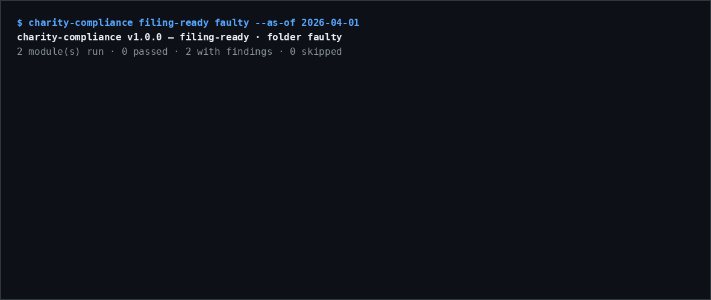

<h1 align="center">charity-compliance</h1>

<p align="center"><strong>Is this charity ready to file? Receipts and the T3010, checked together — one readiness receipt.</strong></p>

<p align="center">
  
  
  
  
  
</p>

<p align="center"></p>

A small Canadian charity's year-end has two mechanical
failure points, and they connect. The donation receipts
it issued from a spreadsheet can carry defects the CRA
takes seriously — a missing prescribed element,
split-receipting math that does not recompute, a serial
used twice. And the T3010 return it files from those
same figures can disagree with itself — a total that
does not cross-foot, line 4500 out of step with the
receipt register, a deadline quietly missed.

charity-compliance checks both halves together. It
validates the year's donation receipts against the
CRA's encoded official-receipt requirements, pre-flights
the draft T3010 return against the encoded completeness
and cross-footing checks, and — pointed at one charity
folder — prints a single readiness receipt: per-module
verdicts, the exact findings, and one READY / NOT READY
line. No LLM. No network. Nothing uploaded; donor data
never leaves the machine.

**What a verdict means — read this first.** The checks
are encoded data: the receipt rules were checked
2026-11 against the CRA's published guidance for
registered charities; the T3010 checks were checked
2026-11-04 against the T3010 (24) form, the T4033 guide
and the CRA's own T3010 checklist. A PASS or a READY
means the data satisfies the checks *encoded in this
suite* — never that the CRA will accept the receipts or
the return. This is a filing-preparation aid: it issues
no receipts, files no returns, handles no SINs, and is
**not tax advice**.

## The receipt family

One grammar — *claims on one side, evidence on the
other, every verdict cited* — across the fleet:

- **[skill-vet](https://github.com/jasveerai88/skill-vet)
  — is it dangerous?** Vets agent skills for stealing,
  spying and hidden sending before you install them.
- **[permission-audit](https://github.com/jasveerai88/permission-audit)
  — what can the agent actually do?** Audits Claude
  Code permission rules against the documented
  deny → ask → allow semantics.
- **[done-claim-auditor](https://github.com/jasveerai88/done-claim-auditor)
  — did the agent do what it claimed?** Audits session
  transcripts for done-claims the evidence contradicts.
- **[skill-claims](https://github.com/jasveerai88/skill-claims)
  — is the package honest?** Checks an agent skill's
  prose promises against its static behaviour.
- **[spec-receipt](https://github.com/jasveerai88/spec-receipt)
  — does the code still match the spec?** Per-item
  drift verdicts between a Markdown spec and the code's
  declared surfaces.
- **[preflight-agent](https://github.com/jasveerai88/preflight-agent)
  — is the agent setup safe to run?** Five setup checks
  (clone-guard, secret-guard, hook-doctor, fleet-audit,
  skill-sprawl) as one scan.
- **charity-compliance — is this charity ready to
  file?** The family's Canadian-compliance member.

Its sibling on the business side:
**[gst-hst-tracker](https://github.com/jasveerai88/gst-hst-tracker)**
— quarterly GST/HST set-aside and the $30,000
small-supplier threshold for Canadian sole proprietors.
Same discipline: CRA-sourced rules, check dates printed
on every report.

## Quick start

```bash
pipx install charity-compliance        # or: pip install charity-compliance
charity-compliance filing-ready path/to/charity-folder
```

*(The PyPI name goes live when v1.0.0 is published;
until then use a source checkout: `pip install .`, or
`pipx install git+https://github.com/jasveerai88/charity-compliance`.)*

Or each checker on its own:

```bash
charity-compliance receipt-gate check DONATIONS.csv [--year YYYY] [--as-of YYYY-MM-DD] [--json]
charity-compliance receipt-gate register DONATIONS.csv [--year YYYY] [--json]
charity-compliance t3010-check check RETURN.json|RETURN.csv [--as-of YYYY-MM-DD] [--json]
charity-compliance t3010-check deadline --year-end YYYY-MM-DD [--json]
```

Pure Python 3.10+ standard library. Local only, no
network, reads the files and writes nothing. Exit codes
everywhere: **0** pass, **1** findings, **2** usage or
input error. Every command accepts `--json` and prints
exactly one JSON object.

From a source checkout, the fixture in `examples/`
builds a fictional charity (Exampleton Community Food
Bank, fiscal 2025) with one planted fault per side:

```bash
python3 examples/make_fixture.py faulty
charity-compliance filing-ready faulty --as-of 2026-04-01   # exit 1 — NOT READY
python3 examples/make_fixture.py clean --clean
charity-compliance filing-ready clean --as-of 2026-04-01    # exit 0 — READY
```

(`--as-of` pins the check date so the receipt is
reproducible; without it, t3010-check judges the
deadline against today — its standalone behaviour.)

## The modules

| Command | Question it answers | Verdict words |
|---|---|---|
| `receipt-gate` | Would these donation receipts survive the CRA's receipt rules? | PASS / FAIL, per-row findings with the rule, the measured value and the limit |
| `t3010-check` | Is this T3010 draft complete, self-consistent, and on time? | PASS / FAIL, grouped ERROR / WARNING / INFO findings with both numbers wherever arithmetic disagrees |
| `filing-ready` | Is this charity — receipts *and* return — ready to file? | READY / NOT READY, one receipt over both modules; a module with no input is SKIPPED with the reason, never passed |

**receipt-gate** checks a donations CSV against the 13
elements an official receipt must carry — statement,
charity name/address, registration number (9 digits +
`RR` + 4 digits, consistent across the file), unique
serial (duplicates are errors, gaps are warnings), place
issued, donation and issue dates in order, donor
name/address, gift amount, in-kind description and
appraiser, advantage amount and description, eligible
amount, and the canada.ca/charities-giving reference.
Split-receipting math is recomputed to the cent
(money is integer cents throughout). An advantage over
80% of the gift is an ERROR — the transfer is not a
gift and no receipt may be issued; over 10% is a
WARNING (the donor's intention must be establishable);
an in-kind gift over $1,000 with no appraiser named is
a WARNING (CRA guidance). Its `register` command prints
the year-end register — serial order, totals, per-donor
totals, unreceiptable rows excluded and marked — whose
eligible total is **the starting figure for the T3010
work**, the number t3010-check ties line 4500 back to.

**t3010-check** pre-flights T3010 data (a JSON model of
the return, or the `field,value` CSV quick path):
completeness against the encoded requirements (required
lines; worksheets T1235 / T1236 / T1441; schedules 1, 2,
3, 4, 5 as the Section C answers trigger them; Schedule
6 when revenue passes $100,000; financial statements;
signed certification; complete T1235 director rows);
exact cross-footing (revenue and expenditure components
vs their totals, the expenditure breakdown, line 4500 vs
the supplied receipt-register eligible total, return
totals vs financial-statement totals, T1236 rows vs line
5050); and the filing deadline — fiscal year-end + 6
months (Income Tax Act s. 149.1(14)), filed-late an
ERROR with the day count. Triggers that need judgement
(Schedule 8, Form T2081, non-arm's-length compensation)
are WARNING prompts, never determinations.

**filing-ready** discovers its inputs in a charity
folder deterministically (recursive, sorted order,
`.git` never entered; extension matching is
case-insensitive — a `DONATIONS.CSV` is still the
donations file):

- receipt-gate gets the first `.csv` whose header names
  both `serial_number` and `donor_name`;
- t3010-check gets the first `.json` return model
  (an object carrying `charity` or `financials`), or
  failing that the first `field,value` `.csv`.

Each section of the receipt is the module's own report,
verbatim. A module with no qualifying input is reported
**SKIPPED with the reason — never as passed**. The
verdict is READY only when at least one module actually
ran and every module that ran passed; a folder with
neither input is NOT READY, not quietly clean.

## The receipt

The faulty fixture plants exactly one fault per side —
an in-kind receipt with its mandatory gift description
removed, and a total revenue (74,800) that no longer
reconciles with its components (74,700). The sides
otherwise tie by construction: the donations register
totals 48,500.00 / 250.00 / 48,250.00, and the return's
line 4500 and `receipts.eligible_total` are both
48,250. This is the complete, unedited output of
`charity-compliance filing-ready faulty --as-of 2026-04-01`
(exit 1):

```text
charity-compliance v1.0.0 — filing-ready · folder faulty
2 module(s) run · 0 passed · 2 with findings · 0 skipped

===== receipt-gate — donation receipts vs the encoded CRA receipt rules =====
receipt-gate v0.1.0 — check of donations.csv (4 row(s))
Encoded rules, checked 2026-11 — verify against the CRA's current guidance for registered charities before relying on them.

ERRORS — receipts that would be invalid, or that must not be issued (1):
  row 4 (serial 104) — required_missing: gift_description is blank — the CRA element it carries would be missing from the receipt (required for a gift in kind)

Verdict: FAIL — 1 error(s), 0 warning(s). Fix the errors before these receipts go out.
receipt-gate is a checking aid: it does not issue receipts, and it is not tax advice. A PASS means the file satisfies the rules encoded in this tool — never a guarantee the CRA accepts the receipts.

===== t3010-check — the draft T3010 return vs the encoded pre-flight checks =====
T3010 pre-flight check — Exampleton Community Food Bank
Source file: faulty/return.json
Rules checked: 2026-11 (sources checked 2026-11-04)
Designation: charitable organization · fiscal period 2025-01-01 to 2025-12-31 · financials: section_d

Verdict: FAIL — 1 error(s), 0 warning(s), 1 note(s)

ERRORS (1):
  [total_mismatch] line 4700: Total revenue: line 4700 shows $74,800 but its components add to $74,700 (4500 $48,250 + 4510 $5,000 + 4530 $3,200 + 4570 $12,000 + 4630 $4,500 + 4640 $1,500 + 4650 $250). Difference: $100.

NOTES (1):
  [filing_deadline] filing_deadline: Filing deadline: fiscal year-end 2025-12-31 + 6 months = due 2026-06-30 (Income Tax Act s. 149.1(14); CRA grants no extensions — verify against current CRA guidance). Filed 2026-03-20, 102 days before the deadline.

Pre-flight checks only. This tool is not a CRA product, a clean run does not mean the return complies with the Income Tax Act, and this is not tax or legal advice. Verify every figure against your records and check the current T3010 form, the T4033 guide and CRA guidance before filing.

VERDICT: NOT READY — findings in receipt-gate, t3010-check — fix each module's section above before the receipts go out or the return is filed.

charity-compliance is a checking aid: it files nothing, issues no receipts, and is not tax advice. A READY verdict means the data satisfies the checks encoded in the two modules (receipt rules checked 2026-11; T3010 checks checked 2026-11-04) — never that the CRA will accept the receipts or the return. Verify against the CRA's current guidance before relying on any verdict.
```

The clean folder, same command (exit 0):

```text
charity-compliance v1.0.0 — filing-ready · folder clean
2 module(s) run · 2 passed · 0 with findings · 0 skipped
[...]
VERDICT: READY — every module that ran passed (receipt-gate, t3010-check). READY covers only the checks encoded in the two modules — it is never a statement that the CRA will accept the receipts or the return. Filing remains a human act.
```

## Contracts

- Every command accepts `--json` and prints exactly one
  JSON object. Module commands emit exactly the object
  their standalone tool emits; `filing-ready` emits one
  combined object whose per-module sections are the
  modules' own objects plus their `exit_code` (skipped
  modules carry `status`, `reason`, `clean: null`).
- Exit codes everywhere: **0** pass, **1** findings,
  **2** usage or input error. Errors — argparse
  included — are `{"error": "..."}` in `--json` mode.
  Never a traceback.
- Read-only: nothing here writes to a checked file or
  folder, and donor data never leaves the machine.

## Why this suite exists — the merge

charity-compliance is flagship B3 of the fleet audit
(FLEET-AUDIT-2026-11-04), which ordered 18 quiet tools
merged into 4 flagships. receipt-gate and t3010-check
were each shipped, tested tools — but they are two
halves of one job (the register's eligible total *is*
the return's line-4500 figure), and nobody was
installing both to answer "are we ready to file?" The
engines are ported **byte-identical** to their sources —
no check, verdict, threshold, or honesty limit changed;
receipt-gate still reports its own v0.1.0 inside its
sections (t3010-check carries no version field, by its
source design). What is new is only the dispatcher and
the combined run — plus one dispatcher-side fix found
in stage 1: discovery originally matched file
extensions case-sensitively, so a `DONATIONS.CSV` was
silently skipped; matching is now case-insensitive,
engines untouched.

## Tests

```bash
python3 -m unittest discover -s tests
```

123 tests: the two source suites ported (60 + 39; the
only edit is each suite's EXAMPLES path, since examples
now live per-module under `examples/<module>/`) plus 24
dispatcher / filing-ready tests. All pass on a clean
checkout — including in a copy with every executable
bit stripped (the suites drive the engines through the
Python interpreter and establish their own fixture
permissions).

## Honest limits

- **A preparation aid, not tax advice.** The suite
  checks data against encoded rules; whether a transfer
  is a gift, what an advantage is worth, and whether an
  appraisal was adequate are questions for the charity's
  own advisors. It issues no receipts and files no
  returns.
- Encoded rules, checked 2026-11 / 2026-11-04, from
  published CRA sources. CRA guidance and forms change;
  the current CRA publications govern. Every report
  carries its check-date stamps and disclaimer — keep
  them attached when you relay a result.
- A spreadsheet check cannot see the printed receipt,
  the actual gift, or the donor's intention; a return
  check cannot see the underlying books. PASS means the
  *data* satisfies the encoded checks.
- receipt-gate assumes one charity, one receipt book
  per file. t3010-check models the return's key lines
  and answers, not every field of every schedule; the
  CSV quick path cannot carry worksheet rows, and those
  checks report themselves skipped (INFO), never
  passed.
- The statement check is a phrase check, not a
  certification of the CRA's prescribed wording.
- No SINs are handled: the inputs are donation-receipt
  fields and return figures only, and nothing in the
  suite asks for, stores, or transmits a Social
  Insurance Number.

## Contributing & security

See CONTRIBUTING.md (stdlib only, engines ported not
rewritten, skipped is not clean) and SECURITY.md
(private vulnerability reporting; the suite is
local-only and read-only by design).

## Support

If this suite saved your charity a filing headache,
sponsoring keeps the receipt family maintained:
https://github.com/sponsors/jasveerai88

## License

MIT — see LICENSE.
